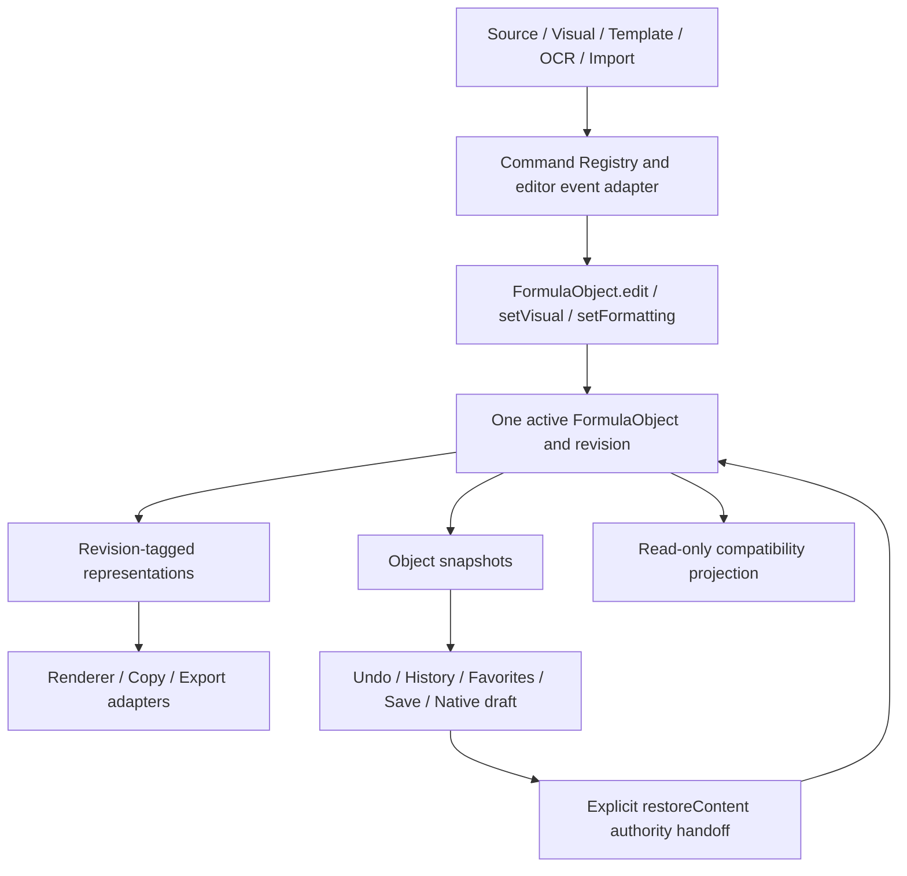

# Unified Formula Object — 2026-10-16

Scope: explicit FormulaObject architecture task, replacing release repair. Original A1–A40 numbering/statuses are unchanged. No OCR environment/model changes; no new app identity; version remains 1.6.2.

## Audit and classification

Before this change there were **three live state surfaces capable of supplying current formula content**, rather than three independent semantic ASTs: `content: FormulaContent`, mutable `state.latex/rawSource`, and the MathLive/source editor buffers. The native host persisted a fourth *copy*, not a concurrently editable authority. History, favorites, render results and clipboard payloads were copies/adapters, but read paths did not consistently distinguish them from current source.

| Location / fields | Classification now | Ownership and permitted use |
|---|---|---|
| `web/app.js: content`, `FormulaObject.content.authority` | AUTHORITY | One active object; exact source and authoritative language, origin, timestamp. |
| `FormulaObject.identity`, object/source revision | AUTHORITY | Formula lineage plus document session id. New/Clear creates lineage; restore explicitly hands authority to a snapshot. |
| `FormulaObject.formatting`, recognition, provenance | AUTHORITY | Layout and OCR candidate metadata belong to object; later source edits retain OCR provenance. |
| `content.representations.latex/typst`, conversions/validation | DERIVED | Exact original or revision-tagged conversion; selecting a representation does not promote it. |
| `content.derived.visual/mathml/svg/native` | DERIVED | Object revision, source revision, producer. SVG/native caches are memory-only; visual/MathML may serialize. |
| `state.latex`, `rawSource`, `visualDraft` | COMPATIBILITY | Read-only getters in `formula-projection.mjs`; attempted writes cannot alter authority. |
| `state.formulaContent`, `state.formulaObject` | SNAPSHOT / COMPATIBILITY | Refreshed from active object before capture/persist. Never read back for ordinary editing. |
| `state.editorMode`, `sourceLanguage` | UI_ONLY projection | Object presentation, not authoritative language. Mode setters cannot edit source. |
| legacy layout fields | COMPATIBILITY | Accessors delegate to object formatting; one compatibility adapter. |
| `#source.value`, MathLive tree | UI_ONLY editing buffers | Input events synchronously submit source / visual mutation; selection, cursor and incomplete input remain editor concerns. |
| `svgResult`, `nativeResult`, alternate source / MathML DOM | DERIVED | Generated from captured object; async render guards reject obsolete results. Output requests render current object rather than reading preview DOM. |
| RevisionHistory.entries / FormulaHistory.formulas/versions | SNAPSHOT | By-value FormulaObject@revision with context; restoring installs sole active object. |
| Favorites (`state.history`), document JSON, localStorage, native draft | SNAPSHOT | Old records remain readable; new records carry FormulaObject, with legacy projections for backward compatibility. |
| OCR candidates, selected indexes, recognition progress | UI_ONLY / input | Candidate set is not active formula. Selection invokes `FormulaImport`/Command Registry with metadata; no direct source DOM writes. |
| Native render source/options, clipboard/export bytes | DERIVED | Host adapters receive request/snapshot; no reverse merge into authority. |
| Batch temporary object | AUTHORITY under exclusive session | Existing command gate blocks concurrent mutation; by-value original is restored, batch objects never persist as user draft/history. |
| Old direct clear button implementation | DEAD / DUPLICATED, removed | Button already routes to `newFormula`; redundant object constructor removed. |
| Old launch swapped-source repair | COMPATIBILITY | Runs only before object adoption; no current-object writes. |

Removed competing **write paths**, not user records. Legacy content reads are confined to explicit deserialization/adoption. Partial legacy histories lacking layout inherit current layout; modern snapshots always use their own object settings. Serialized object wins over conflicting legacy source, visual draft and content record.

## Actual schema

```text
FormulaObject snapshot
  objectVersion: 1
  identity: { formulaId, documentId }
  revision: object revision
  content:
    schemaVersion: 1
    revision: source revision
    authority: { language, text, origin, timestamp }
    representations: { latex?, typst? }
      { text, revision, sourceLanguage, kind, fidelity, converter? }
    conversions: { language: { status, revision, fidelity?/message? } }
    validation: pending | parsed
  presentation: { mode: visual | latex | typst }
  formatting: documentSnapshotSettingKeys
  provenance: [{ revision, origin, language, time }]
  recognition: null | { engine, kind, mode, source, detector, formulas, raw, ... }
  derived: { visual?, mathml? }
    { value, revision, sourceRevision, producer }
```

Object revision also covers layout, OCR metadata and editable visual placeholders; source revision covers actual source edits. Presentation switching is not a content revision. OCR `formulas` preserves original returned candidate records (including bbox when provided). Source identifier/detector is nullable when the host does not supply it; image bytes are not duplicated into every revision. Existing source conversion remains unverified/lossy where the converter cannot guarantee equivalence; this is not a semantic AST.

## Code dataflow and entries



- **Create/adopt:** `restoreContent` (launch, document import, history/favorite/undo restore); `newFormula` (new identity). Constructor validation rejects inconsistent modern snapshots. There is no separate OCR-created active object.
- **Mutate:** source input/readSource → `edit`; `syncVisual` → `edit('latex', ..., 'visual')` and `setVisual`; template/structural commands use those same editor adapters; `loadLatex` → `edit(...,'generated')`; plain import/OCR → `edit(...,'import'/'ocr',metadata)`; layout compatibility setter → `setFormatting`. Candidate deselection submits an empty OCR import through the same command transaction.
- **Snapshot:** `captureContent`, `formulaSnapshot`, `captureRevision`; FormulaHistory/RevisionHistory own deep copies. Save/favorites/native persistence serialize snapshots; document lifecycle identity remains native session-owned.
- **Projection:** `formula-projection.mjs` alone exposes current legacy source/layout/presentation fields. `editor-mode.mjs` derives sourceLanguage.
- **Read/output adapters:** `contentSource` (LaTeX/Typst), MathLive MathML, MathJax SVG, canvas raster, jsPDF PDF, native LaTeX/Typst render, native/browser clipboard and file save/drag. Office MathML/graphic compatibility uses existing host adapters; this task does not claim native editable Office support beyond existing implementation.
- **Native host:** macOS native PDF metadata now embeds the passed object snapshot rather than reassembling source/layout. Hosts still support legacy requests lacking document data; those callers are compatibility adapters, not active formula state.

## Tests and delivery evidence

`tests/formula-object.cjs` and `tests/formula-object-editor.cjs` register in `scripts/test-editor.cjs`.

| Requested case | Evidence |
|---|---|
| 1 LaTeX | Exact source, source revision increment, derived Typst invalidation/generation; saved/history/SVG snapshots. |
| 2 Typst | Authority switches only after actual source edit, same lineage; revision-tagged regenerated LaTeX. |
| 3 Visual | Visual input updates authority/origin; obsolete Typst source cannot survive as current representation. |
| 4 OCR | Engine/candidate bbox stored in object; subsequent editing retains lineage/recognition. Existing OCR selection/import suites cover bridge routing. |
| 5 History | A→B→C, restore B object content, keep OCR metadata; existing history suite covers branching/search/restart. |
| 6 Undo/Redo | Exact object source/metadata restored, including history restore undo; setting and ownership suites retained. |
| 7 Save/Reopen | Conflicting legacy fields cannot override object; fresh browser process restores durable object, formatting and placeholders covered by document/draft suites. |
| 8 Copy/Export | Legacy setters are tampered; native copy payload and saved JSON/SVG metadata still read object. |
| 9 Mode switch | LaTeX↔Typst↔Visual without edit preserves authority, source and object revisions. |
| 10 Regression trap | Writes to legacy latex/rawSource/formulaContent do not affect render metadata, History, Save or Copy. |

Full editor regression and final affected/host tests are recorded in the task delivery report. Headless bridge payload verification is not actual Word/Pages/WPS paste acceptance. No new real OCR inference/download is needed for this architecture change.

## Limits / completion gate

The frontend active-object paths are unified. Windows native LaTeX/Typst-generated PDF/SVG still omit embedded FormulaObject recovery metadata, and Windows graphic clipboard ignores the equation recovery payload. These are lossy **output snapshots**, not a second live authority, but mean the strongest cross-platform metadata-continuity claim is not complete. Existing Word/WPS/Pages adapters have not been newly validated in those applications. This iteration must be reported **PARTIAL**, with these exceptions, until covered and accepted; do not label the entire requested architecture COMPLETE merely because browser tests pass.

No GitHub write is authorized for this iteration before actual user acceptance and explicit push authorization (AGENTS.md). No Release repair or other A task is included.
